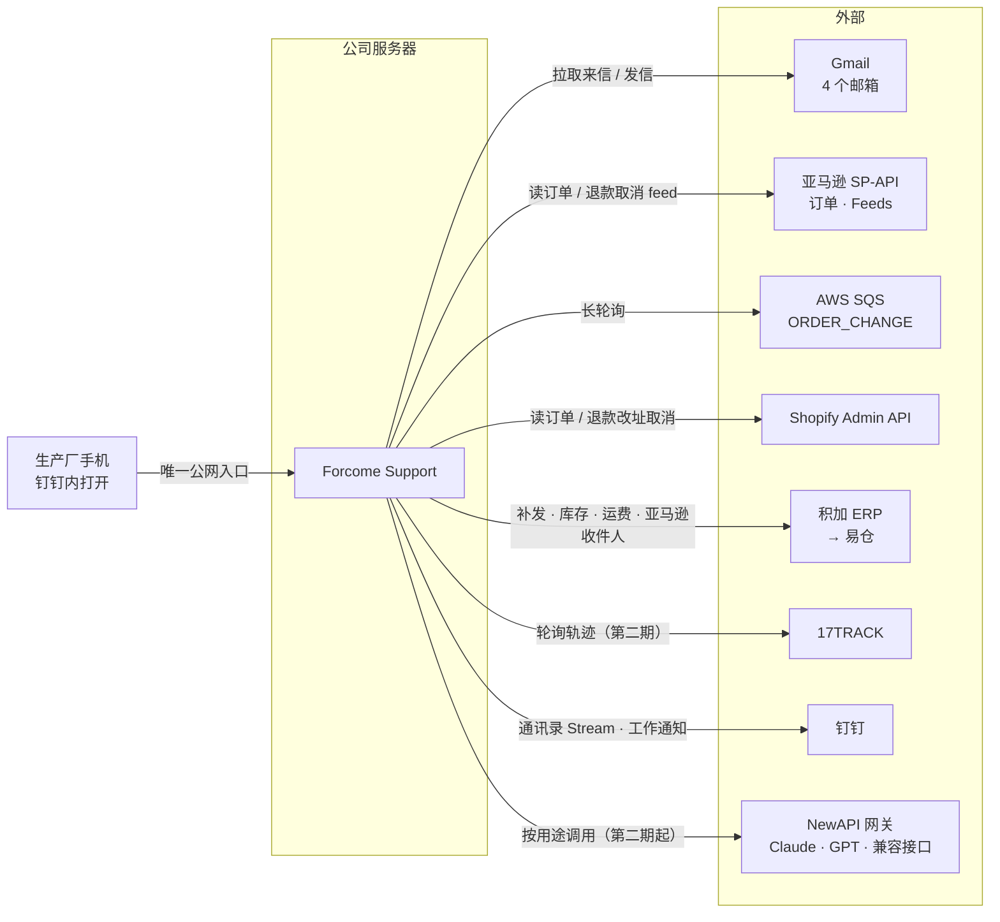
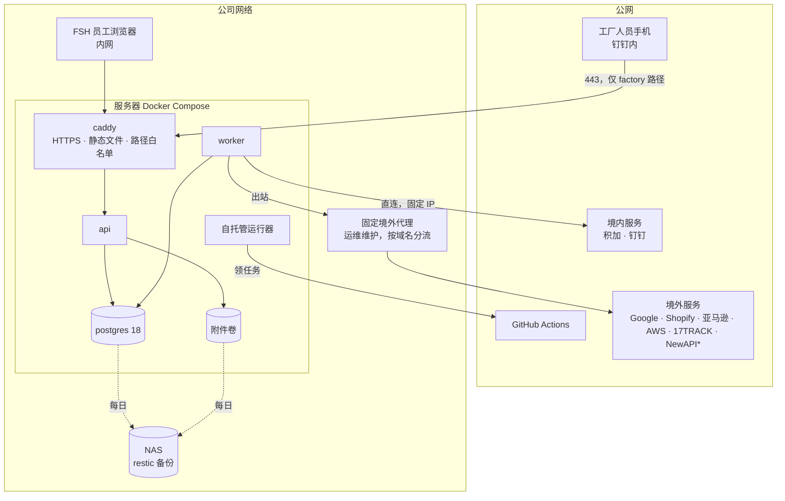

# Forcome Support 技术方案

> 版本 v1.0 · 2026-09-24 · 对应 PRD v2.8（`design/spec/prd_a.md`–`prd_d.md`）

## 0 文档说明

**目的**：汇总生产系统的架构与选型，架构按三期完整功能来定，细化到可实施的程度只做第一期（报表与台账），足以直接进入 `/to-spec` → `/to-tickets` → `/implement`。

**读者**：实现待办的 AI 编程代理、把关的 1–2 名工程师、运维。

**与其他文档的关系**：
- **PRD** 管业务：规则、页面、状态、验收，编号（R-、P、E-、AC-、D-）沿用 PRD。
- **ADR**（`docs/adr/0001`–`0014`）管「为什么这么定」：每项决策的备选方案与后果。本文只写结论，理由看 ADR。
- **调研报告**在各 `research/*` 分支上（附录 B），写的是事实与来源。
- **术语**：业务术语见 PRD 1.4，项目级术语见 `CONTEXT.md`。

**已定的前提**：
- 团队：TypeScript 小团队，以 AI 编程代理按待办实现为主，1–2 人把关；第一期 6–8 周上线。
- 部署：私有化部署在中国大陆的公司服务器，有运维，前期 Docker Compose。
- 合规：整个方案不考虑合规，按最佳体验设计（ADR 0004）。
- 模型：经 NewAPI 网关接入，同时适配 Claude、OpenAI GPT 与 OpenAI 兼容接口（ADR 0001）。

## 1 总览

### 1.1 系统边界



所有箭头都是**系统主动连出**，唯一的入站是工厂人员访问工厂工作台（ADR 0003）。

### 1.2 关键决策一览

| 领域 | 结论 | ADR |
|---|---|---|
| 部署 | 大陆公司服务器；境内直连、境外经固定代理；外部系统零入站，工厂工作台是唯一公网入口 | 0003 |
| 数据口径 | 不做个人信息脱敏与到期删除；审计记录完整前后值 | 0004 |
| 架构 | 模块化单体，lint 强制模块边界，跨模块走领域事件 | 0005 |
| 后端 | Node 24 + Hono + Drizzle + PostgreSQL 18；锁与实时推送都落在数据库上 | 0006 |
| 前端 | Vite + React 19 单页应用；工厂工作台是独立构建入口 | 0007 |
| 后台任务 | pg-boss，任务表即发件箱；状态机手写迁移表；时限每分钟扫描 | 0008 |
| 集成 | 形状对齐 MCP 的进程内统一动作接口；每个适配器配 Fake | 0009 |
| 外部数据来源 | 按记账方分工；订单改为平台直读，积加只补收件人与履约 | 0002、0011 |
| 身份权限 | 服务端会话；固定角色；店铺范围与生产厂隔离在应用层强制 | 0010 |
| 模型接入 | 按 11 个用途配置、应用层切换；不加网关与可观测平台 | 0001、0012 |
| AI 处理 | 五步流水线 + 意图流程；治理以代码为主；回归集门控 | 0014 |
| 工程运维 | GitHub + Actions，内网自托管运行器部署；动态凭据加密存库 | 0013 |

## 2 部署拓扑（ADR 0003、0013）



\* NewAPI 部署在哪由网关方决定，出站统一经代理配置。

| 项 | 做法 |
|---|---|
| 服务器 | 中国大陆公司机房，Docker Compose |
| 出站 | 系统只配置一个 `HTTPS_PROXY`；按域名分流由运维在代理侧维护（境内直连、境外走代理），我们提供放行域名清单；积加 IP 白名单登记公司固定 IP |
| 入站 | 对外部系统零入站：Gmail（Pub/Sub pull + `history.list`）、钉钉（Stream）、Shopify（轮询）、SP-API（SQS 长轮询 + feed 回执轮询）、17TRACK（轮询） |
| 公网入口 | 公司固定 IP 上一个子域名，HTTPS（Let's Encrypt，DNS 验证）；caddy 只放行 `factory.html` 的静态资源、`/api/factory/*` 与钉钉免登接口，并限制访问频率。**第一期没有工厂工作台，不需要开这个入口** |
| 环境 | 生产与开发测试同机，独立 Compose 项目与数据库；开发测试默认用 Fake 适配器 |
| 备份 | 每天凌晨 `pg_dump` + 附件卷，restic 加密去重同步到 NAS，保留 30 份日备份与 12 份月备份；RTO 4 小时；每季度恢复演练 |

**Compose 服务**：`caddy`、`api`、`worker`、`migrate`（一次性）、`postgres`。没有 Redis、对象存储或其他中间件；所有状态都在 PostgreSQL 与附件卷里。

## 3 架构与代码组织（ADR 0005）

### 3.1 模块

| 模块 | 负责 | 主要对象（PRD 11.1） | 阶段 |
|---|---|---|---|
| `org` | 成员、部门、钉钉同步、登录、角色与店铺范围 | Member、Department | 一 |
| `channel` | 店铺与邮箱；收取、识别、去重、归并成工单 | Store | 一 |
| `order` | 本地订单镜像：平台订单、发货与单号快照，积加补充的收件人与履约 | （新增）Order | 一 |
| `ticket` | 工单、消息、客户档案、状态机、SLA、编辑锁、回复发送 | Ticket、Message、Customer | 一（只读）、二 |
| `aftersales` | 售后单、登记台账、比例协商、内部结算 | AfterSales、NegotiationRound、SettlementBatch | 一（台账）、二 |
| `approval` | 审批单、审批项、人工操作清单、动作执行 | Approval、ApprovalItem、ManualTask | 二 |
| `factory` | 生产厂、工厂任务、留言 | Factory、FactoryTask、Comment | 二 |
| `ai` | 五步处理、草稿、意图流程、评测 | Draft | 三（翻译、摘要在二） |
| `knowledge` | 知识条目、素材 | Knowledge | 三 |
| `report` | 报表与导出（只读各模块的表） | — | 一 |
| `integration` | 全部外部适配器与客户端、统一动作接口、模型接入层 | — | 基础设施 |
| `core` | 审计、工作日历接入、编号、通知、配置、存储 | AuditLog、WorkHours | 基础设施 |

设置页的配置归各自模块（例如 P23 售后规则归 `aftersales`、P25 模型归 `integration`），不单设模块。

### 3.2 边界规则

- 模块只通过自己 `index.ts` 导出的服务与类型被调用；不跨模块读写表。唯一例外：`report` 用只读数据库角色直接读各模块的表。
- 一个模块的状态变化需要另一个模块响应时，在业务事务内发领域事件（插入 pg-boss 任务），由 `worker` 处理（ADR 0008）。
- 边界由 dependency-cruiser 或 eslint-plugin-boundaries 在 CI 中强制检查。

### 3.3 仓库结构

```
apps/web            前端：index.html（主应用）+ factory.html（工厂工作台）
apps/server         后端：src/modules/<模块>/，入口 api.ts、worker.ts、migrate.ts
packages/contracts  前后端共享的 zod 模式、类型、状态枚举中英对照、能力矩阵、ai/ 下的模型输出模式
packages/calendar   工作日历纯函数（R-CL-01、R-CL-02），前后端共用
packages/config     共享 tsconfig、eslint 配置
docs/ design/ .scratch/  保持现状
```

pnpm workspace，暂不引入 Turborepo 或 Nx。

### 3.4 命名

标识符用 PRD 11.1 的英文对象名；状态、枚举、表名、列名用英文 snake_case，中英对照放在 `contracts`；注释、提交信息、文档用中文，并在注释里标注业务规则编号（例如 `// R-AP-05`）。

## 4 后端与数据（ADR 0006）

| 项 | 选型 |
|---|---|
| 运行时 | Node.js 24 LTS |
| Web 框架 | Hono + `@hono/zod-openapi`：REST，接口直接用 `contracts` 的 zod 模式声明，自动生成 OpenAPI；前端用 `hono/client` 拿类型 |
| 数据库 | PostgreSQL 18，一个库，一个模块一个 schema；`report` 用只读角色；pgvector 扩展（第三期） |
| 数据访问 | Drizzle ORM，表结构写在各模块目录；drizzle-kit 生成 SQL 迁移并提交进仓库 |
| 迁移 | 只向前；部署时先跑 `migrate` 容器；生产迁移前自动备份；破坏性变更分两次发版（ADR 0013） |

**数据约定**：
- 主键 UUIDv7；业务编号（`T-`、`AP-`、`S-`、结算批次）另设一列，由 `core` 在事务内生成。
- 时间一律 `timestamptz`（UTC）；工作日历按北京时间计算。
- 金额 `numeric(12,2)` + 币种；报备另存汇率与美元折算值。
- 主表带 `version` 列做乐观锁；不做软删除，作废与取消用状态表示。

**锁**：编辑锁（R-TK-06，5 分钟）与处理锁（R-AP-03，10 分钟）都是数据库租约行（持锁人、加锁时间、最后活动时间），前端每 30 秒心跳，单条 SQL 原子取锁。

**审计**：服务层在写事务内记录操作人、角色、来源 IP、完整前后值；系统操作记为「系统」；登录、登出、强制接手、导出也记；只读查询不记。

**实时推送**：SSE。数据变化时 `NOTIFY`，api 监听后向浏览器推「某对象变了」，前端让对应缓存失效后重新拉取。

## 5 前端（ADR 0007）

| 项 | 选型 |
|---|---|
| 框架 | Vite + React 19 单页应用，静态文件由 caddy 托管 |
| UI | shadcn/ui + Tailwind CSS v4（PRD D-10） |
| 路由 | TanStack Router；查询参数经 zod 校验，筛选条件放在 URL（支撑「带筛选跳转 P04 / P13」） |
| 数据 | TanStack Query（SSE 触发失效）；TanStack Table + shadcn Data Table；react-hook-form + `contracts` 的 zod 模式；shadcn Charts（Recharts）；必要时用 Zustand |
| 令牌 | 一次性脚本把 `design/spec/ui.py` 的 `T` 转成 `globals.css`，此后以它为准；原型改令牌时同步两边 |
| 密度 | `<html data-density>` 切换两套 CSS 变量，偏好存服务端 |
| 屏幕 | 主应用只支持桌面 ≥ 1280px；工厂工作台响应式、以手机为主 |
| 语言 | 界面只做中文，不引入 i18n |
| 测试 | Vitest + Testing Library；Playwright 覆盖 PRD 第 13 节验收；视觉对照原型人工验收 |

原型（`design/`）是界面规格与验收依据，不进入生产代码。

## 6 集成（ADR 0002、0009、0011）

### 6.1 数据来源

| 数据或动作 | 来源 | 同步方式 | 阶段 |
|---|---|---|---|
| 客户来信与我方发信 | Gmail（4 个邮箱，服务账号 + 全域委派） | Pub/Sub pull 常驻 + 每 5 分钟 `history.list` 兜底；「已发送」也同步 | 一 |
| 亚马逊订单（状态、商品行、MFN/AFN、承诺时效、城市/州/国家、MFN 单号） | SP-API Orders v2026-01-01，只用非受限角色 Inventory and Order Tracking | `ORDER_CHANGE` → SQS 长轮询 + 每 3–5 分钟 `lastUpdatedAfter` 增量兜底 | 一 |
| Shopify 订单（含客户邮箱、收件地址、履约单号） | Shopify Admin GraphQL API（自建应用，令牌 24 小时刷新） | 每 1–2 分钟 `updated_at` 增量 | 一 |
| 组织与登录 | 钉钉（企业内部应用） | Stream 长连接 + 每小时全量对账 | 一 |
| 亚马逊买家姓名与收件地址 | 积加订单详情（订购一个月内） | 补发时按需查询 | 二 |
| 补发（易仓售后出库单）、出库状态与单号、易仓库存、实际运费 | 积加（自发货订单新增 V2 补单 → 易仓） | 按需 + 轮询（运费次日可得） | 二 |
| 物流轨迹 | 17TRACK | 每 4 小时一轮 + 工单打开时即时查询 | 二 |
| 亚马逊退款、取消 | SP-API Feeds（订单调整 feed、订单确认 feed），最长约 8 小时出结果 | 每 5 分钟查未完成的 feed | 二 |
| Shopify 退款、改地址、取消、订单备注 | Shopify Admin API（`refundCreate` 带幂等键） | 同步 | 二 |
| 模型 | NewAPI 网关 | 按用途调用 | 二起 |

本地由 `order` 模块维护订单镜像：上线时回补 90 天、每天夜间对账近 7 天，以平台订单号为关联键；积加数据只补充收件人与履约。

### 6.2 统一动作接口

- 只有 PRD 的 9 个动作走这个接口（查订单、查物流、查库存、回复客户、创建售后出库单、订单备注、退款、改地址、取消）。每个动作一份定义：名称、分级、输入输出的 zod 模式、`execute(上下文, 输入)`；上下文含店铺、幂等键、截止时间、操作人。形状对齐 MCP 工具规范，以后可随时包成 MCP 服务器。
- 结果：`succeeded`、`pending`（已受理、等回执，带外部引用）、`failed_retryable`、`failed_permanent`、`unknown`（先查询再决定）。
- 「动作 × 平台 → 适配器」映射存数据库，P22 编辑；凭据只在 `integration` 内按店铺 ID 取用（R-ST-03）。
- 能力缺口（平台不支持、适配器未接通、发起人选择转人工）按「动作 × 平台」步骤模板生成人工操作清单；亚马逊改地址由草稿引导买家取消后重新下单。
- Gmail 收信、钉钉同步、17TRACK 轮询、订单同步不是动作，是 `integration` 的普通客户端。

### 6.3 出站与调用记录

- 所有外部调用经同一个 HTTP 客户端工厂（undici `EnvHttpProxyAgent`；gRPC 与钉钉 Stream 读同一组代理环境变量）。
- 按外部系统限流（积加每秒 2 次、17TRACK 每秒 3 次、SP-API 按各接口配额）。
- 每次外部调用写一条调用记录（系统、动作、店铺、耗时、状态码、请求与响应摘要），用于排错、P18 连接状态与 P26 系统状态。

### 6.4 Fake 适配器

每个适配器配一个 Fake，能模拟成功、失败、超时和异步回执；按店铺配置选择真实现或 Fake。本机开发、CI 集成测试、开发测试环境默认用 Fake，外部接口开通后逐个店铺切换。**这是积加与 SP-API 尚未开通时仍能端到端开发第一期的前提。**

## 7 后台任务与流程（ADR 0008）

| 项 | 做法 |
|---|---|
| 队列 | pg-boss；业务事务内插入任务，任务表即发件箱 |
| 状态机 | PRD 第 6 章每个状态机写成纯函数迁移表（当前状态、事件、守卫、目标状态），放在所属模块，单元测试全覆盖；只能经迁移表改状态 |
| 时限 | 每分钟扫描截止时间列：SLA、审批 4 小时与剩 1 小时提醒、生产厂任务截止与催办、人工操作清单 4 个工作小时、工单 7 天自动关闭；「已提醒」标记防重复 |
| 定时 | 月度结算批次 cron，以「生产厂 + 月份」为单例键 |
| 工作日历 | `packages/calendar` 纯函数，前后端共用，配置从服务端读 |
| 动作执行 | 幂等键；重试间隔 1、5、15 分钟（R-AP-05）；3 次失败后由发起人决定重试或转人工；结果不明先查询 |
| 常驻连接 | Gmail pull、SQS 长轮询、钉钉 Stream 用 PostgreSQL advisory lock 选出唯一持有者，挂掉后自动接手 |

## 8 身份与权限（ADR 0010）

- **会话**：服务端会话存 PostgreSQL，httpOnly、Secure Cookie；无操作 7 天过期；钉钉扫码登录与钉钉内免登换出同一种会话；主应用与工厂工作台 Cookie 各自独立。
- **同步与停用**：成员停用时立即失效会话、释放锁，负责的工单与售后单转「待分配」并通知客服主管；是备用审批人时提醒管理员。
- **角色**：6 个固定角色；PRD 10.1 能力矩阵是 `contracts` 中的常量，前端据此显示、后端据此强制；可多角色，权限取并集。
- **店铺范围**（R-ST-06）：仓储查询必须接收带授权店铺列表的上下文参数，缺了编译不过；越权场景有测试覆盖；不用 RLS。
- **生产厂隔离**（R-FT-02）：`/api/factory/*` 专用输出结构；生产厂 ID 只取自会话；寄件完成 30 天后对生产厂隐藏收件信息。
- **钉钉通知**：内容带对象编号与时间，避免「同内容一天一条」被静默吞掉；同一人 5 分钟内合并；统计配额。

## 9 AI 处理（ADR 0001、0012、0014）

### 9.1 模型接入层

- 接入：Vercel AI SDK。Claude 经 NewAPI 走 Anthropic 原生 `/v1/messages`；GPT 走 Responses；其他兼容接口走 Chat Completions。锁定原生结构化输出模式（Opus 5.5、Fable 5.1 禁止强制工具调用）。
- **按用途调用**，业务代码不写模型名。每个用途配置主备模型、推理强度、输出上限、时限、提示词版本、模式版本；配置存数据库，管理员在 P25「模型」页切换。

| 用途 | 做什么 | 阶段 |
|---|---|---|
| `translate` | 来信与回复译文、中文修改后回译 | 二 |
| `summarize` | 对话摘要、客户历史摘要 | 二 |
| `extract` | 订单号、字段抽取，历史导入的自由文本列 | 二 |
| `assess` | 售后责任与处理方式建议（含看图） | 二 |
| `triage` | 风险、意图、情绪、语言、紧急度、注入嫌疑一次完成 | 三 |
| `draft` | 3 版草稿（一次调用）、换一版 | 三 |
| `check` | 回复检查中「承诺是否越政策」 | 三 |
| `knowledge` | 知识缺口聚类、沉淀起草、处理说明修改建议 | 三 |
| `judge` | 评测打分 | 三（上线前） |
| `embed`、`rerank` | 知识检索（pgvector） | 三 |

- **时限与熔断**：60 秒总时限只管 `triage` + `draft`（E-03），其他用途各设时限；关闭 SDK 自带重试；熔断按「用途 × 模型」统计，失败则改用备用模型，备用也失败时同步用途直接走 E-03 降级。NewAPI 管渠道切换，应用层管模型切换。
- **调用记录**：AI SDK 遥测写入自有表：用途、模型、提示词与模式版本、上下文清单、四项用量（拿不到记 null）、成本、耗时、停止原因、校验结果、降级路径、关联对象、完整请求与响应；长期保留，兼作评测样本与成本数据源。
- **不引入**：LiteLLM、Portkey、OpenRouter、Langfuse、Braintrust、专用向量库、多智能体框架。

### 9.2 编排与治理（第三期）

- **工作流**：五步处理（PRD 5.1）是固定的外层流水线；`draft` 不开放工具，数据由代码按意图预取。
- **意图流程**：每个意图 = 结构化部分（需要的信息、预取清单、允许的动作与前置条件、默认发送方式、阈值，代码执行）+ 自然语言处理说明（客服主管在 P19「处理说明」页签维护，带版本，发布前跑回归）。
- **上下文 7 段**：① 系统提示 ② 店铺层 ③ 意图层（前三段可缓存）④ 客户与工单（摘要 + 最近 4 封）⑤ 事实（带证据编号）⑥ 本封来信（JSON 编码，不可信内容）⑦ 任务指令与当前时间。知识按「店铺 × 语言 × 渠道 × 意图 × 有效期」过滤，放得下就全部放入，放不下用 pgvector 检索。
- **治理**：动作只能取当前意图允许的枚举，前置条件由代码判定；R-CK 以规则和证据编号核对为主，模型只判断承诺是否越政策；承诺与审批项双向对账；风险信号「疑似提示注入」；放开自动发送前回归集连续 5 次全部通过（R-SD-06）。
- **意图与情绪**：来源类别；置信度为可复算的综合分（R-SD-05）；每封新来信重新判定；意图一致率 ≥ 95% 才上线；风险信号逐项带原文证据，关键词与模型取并集；紧急度字段。
- **评测闭环**：回归集 = Q-08 的 500 封历史样本 + 被拒草稿 + 知识缺口来源工单；代码打分 + `judge` 打分（先与客服主管人工评分对齐 50 条）；任何变更先跑回归；线上看采纳率、修改幅度、拒绝与转人工原因。

## 10 工程与运维（ADR 0013）

| 项 | 做法 |
|---|---|
| 托管 | GitHub 私有仓库 |
| CI | GitHub Actions：类型检查、lint（含边界）、单元测试、集成测试（真实 PostgreSQL 18 服务容器 + Fake）、至少 1 名人工评审；合并后对开发测试环境跑 Playwright |
| CD | 内网自托管运行器（主动连出）：main 自动部署开发测试；打标签 + 人工批准后部署生产 |
| 监控 | 先确认运维现有系统，有则接入健康检查与指标接口；没有则 worker 每分钟自检（队列积压、失败任务、各数据源最近同步时间、外部调用错误率、模型熔断、配额），异常发钉钉群机器人，P26 系统状态页展示 |
| 日志 | pino JSON → Docker json-file 轮转，保留 30 天；业务追溯靠审计表与两类调用记录 |
| 密钥 | 静态密钥放服务器 `.env`（600，运维保管）；动态凭据（各店铺 Shopify 令牌、SP-API 刷新令牌）用主密钥 AES-GCM 加密存库；主密钥随备份单独离线保管 |
| 本机开发 | `docker-compose.dev.yml` 起 PostgreSQL，全部用 Fake，不需要任何外部账号 |

## 11 分期落地

### 11.1 第一期：报表与台账（6–8 周）

**范围**（PRD 3.2）：F-OR-01、F-CH-01–04（收取与归并、平台订单同步；物流轨迹随第二期）、F-ST-01、F-RP-01（第一阶段范围）、F-LG-01。验收：报表替代人工导出；当月售后单登记完整率 ≥ 98%。

**页面**：登录；P17 报表；P13 登记台账（手工登记与补登）；P04 工单列表与 P05 工单详情的只读版（报表下钻核对）；P18 渠道与店铺；P20 团队与权限。

**涉及模块**：`org`、`channel`、`order`、`ticket`（只读）、`aftersales`（台账）、`report`、`core`、`integration`（Gmail、钉钉、SP-API 订单、Shopify 订单）。第一期**不接**积加、17TRACK、模型，也**不开**公网入口。

**关键口径**：
- **归并**：来信按 R-TK-01 归并到「店铺 + 订单」；亚马逊来信取信中的订单号，Shopify 与直邮按客户邮箱反查订单镜像。
- **首次回复与 SLA**（Q-26）：按 Gmail 线程与 `In-Reply-To`、`References` 把我方发信对应到客户来信；报表注明「只统计经店铺邮箱发出的回复」。
- **报表**：直接查业务表（SQL 视图 + 索引）；「更新于」显示各数据源最近一次同步成功的时间；以后变慢再改物化视图。时效目标 T+0、15 分钟内。
- **台账**：每行就是一张售后单（与第二期同一张表），创建路径「手工登记」，状态先用简化版。
- **历史导入**（PRD 第 14 节）：近 90 天邮件走线上同一条流程导入，标「历史」、不触发 SLA；售后登记表用一次性命令行导入（映射表拿到真实表格后定），缺失字段标「历史导入」；订单回补 90 天。
- **导出**：服务端 exceljs 同步生成，记入审计。

**先决条件**（「事务：申请积加开放接口与 SP-API 开发者资质」跟踪）：
1. SP-API 私有开发者资质与非受限角色 Inventory and Order Tracking；订阅 `ORDER_CHANGE`。
2. AWS 账户与 us-east-1 SQS 标准队列。
3. Shopify Dev Dashboard 自建应用（受保护客户数据：邮箱、地址）。
4. Google Workspace 服务账号 + 全域委派（4 个邮箱）、Pub/Sub 主题与订阅。
5. 钉钉企业内部应用（通讯录只读、登录、工作通知）；确认钉钉版本。
6. GitHub 私有仓库；服务器、代理放行域名清单、NAS。

外部资质没到位之前，全部功能用 Fake 开发与验收；到位后逐项切换。

**建议的实施切片**（供 `/to-spec`、`/to-tickets` 参考，每片可独立验收）：

| 顺序 | 切片 | 依赖 |
|---|---|---|
| 1 | 工程骨架：仓库结构、CI、边界 lint、Compose、`migrate`、`core`（审计、编号、配置）、Fake 框架、部署到开发测试环境 | — |
| 2 | 组织与登录：钉钉同步、扫码登录、会话、角色与店铺范围、P20 | 1 |
| 3 | 店铺与渠道：P18、店铺配置、Gmail 客户端（Fake → 真实） | 1、2 |
| 4 | 订单镜像：SP-API（SQS + 增量）与 Shopify 同步、`order` 模块、90 天回补 | 1、3 |
| 5 | 收取与归并：去重、店铺与来源识别、订单关联、R-TK-01 归并、未归属店铺队列 | 3、4 |
| 6 | 回复识别与 SLA：「已发送」同步、线程匹配、首次回复、SLA 计算 | 5 |
| 7 | 工单只读：P04、P05 | 5、6 |
| 8 | 登记台账：售后单（简化状态）、手工登记与补登、P13、导出 | 2 |
| 9 | 报表：P17 指标与图表、下钻、导出、「更新于」 | 6、7、8 |
| 10 | 历史导入：90 天邮件回放、售后登记表导入命令 | 5、8 |
| 11 | 运维落地：备份脚本与演练、监控自检、生产部署与切换 | 全部 |

### 11.2 第二期：售后流程（架构已定，不细化）

新增：`approval`、`factory`；`ticket` 全功能（回复发送、编辑锁、SLA 实时计时）；`aftersales` 全流程；集成积加（补发、库存、运费、亚马逊收件人）、17TRACK、SP-API Feeds 与 Shopify 写动作；工厂工作台（`factory.html`）与公网入口；模型接入层与 `translate`、`summarize`、`extract`、`assess`；P25、P26。

### 11.3 第三期：AI 回信（架构已定，不细化）

新增：`ai`、`knowledge`；五步处理、意图流程与 P19「处理说明」、`triage`、`draft`、`check`、`knowledge`、`judge`、`embed`（`rerank` 可选）；回归集与打分细则必须在上线前建好。与海帆并行 2 周，按意图逐个切换（PRD 第 14 节）。

### 11.4 编排演进

前期 Docker Compose 足够：单机、每天约 300 封来信、api 与 worker 各一个容器。出现以下任一情况时，再评估迁移到更正式的编排（如 K3s 或云上托管 Kubernetes）：
- 需要多台服务器（高可用或负载），单机停机无法接受 RTO 4 小时；
- api 或 worker 需要按负载自动扩缩；
- 部署频率与环境数量（例如按 PR 起预览环境）超出 Compose + 自托管运行器的管理能力。

迁移前提已在架构中满足：无状态的 api 与 worker、状态全在 PostgreSQL 与附件卷（附件经 `core` 存储接口，可换成对象存储）、常驻连接用 advisory lock 选主、SSE 靠 `LISTEN/NOTIFY` 支持多实例。

## 12 风险与待确认

### 12.1 风险

| 风险 | 影响 | 应对 |
|---|---|---|
| 积加开放接口订单为隔天（与文档「1 / 5 分钟」不符） | 已改为平台直读，只影响收件人与履约数据的时效 | 向积加确认具体慢在哪（O-6） |
| SP-API 新版订单接口读不到积加回传的 MFN 单号 | 亚马逊单号需从积加取，时效变差 | 开通后第一周实测（O-2）；读不到就退回积加 |
| 积加补单参数未确认 | 第二期补发无法全自动 | 退路：系统生成补发任务、坐席在积加界面建单 |
| 境外代理中断 | 来信、订单、模型、GitHub 全部中断 | 运维负责代理可用性；P26 与群机器人告警 |
| 钉钉标准版配额（每月 5,000 次调用） | 通知可能超额 | 确认版本；合并通知、监控配额 |
| AI SDK 大版本迭代快 | 升级引入行为变化 | 锁定版本，升级前跑回归 |
| 不做个人信息治理 | 以后补合规成本随时间上升 | ADR 0004 已记录，风险由业务自担 |

### 12.2 待确认（按负责方）

| 负责方 | 事项 | 出处 |
|---|---|---|
| 积加 | 补单参数（`sourceChannel`、`sourceCode`、`warehouseId`、金额填 0）；易仓侧取消后的同步；1035 凭证是否脱敏；轨迹接口；开通费用与测试环境；订单「隔天」具体指什么；订单详情收件地址能否满足补发 | `.scratch/tech-plan/积加技术问题清单.md`；`research/order-source` O-6、O-7 |
| FSH | 美、加、墨是否同一北美统一账户；两个 Shopify 店铺的套餐与组织；4 个邮箱是否为真实用户；易仓服务商名称与 OMS 地址；集团钉钉版本；历史售后登记表样本 | `research/sp-api`、`research/gmail-shopify-dingtalk`、`research/order-source` O-4、O-5 |
| 运维 | 现有监控与日志系统；代理放行域名清单；公网子域名与证书（第二期） | ADR 0013、0003 |
| 研发实测 | `ORDER_CHANGE` 延迟、`packages[]` 单号、非受限角色字段（O-1–O-3）；钉钉 Stream 经代理；NewAPI 的嵌入、重排与批处理透传（U-07、U-08）；知识过滤后的 token 量（U-01） | 各调研报告 |
| 客户 | 默认 3 版草稿是否保留（U-05）；全量质量分与话题洞察是否纳入（U-13） | `research/llm-uses` |

## 附录 A：ADR 索引

| 编号 | 标题 |
|---|---|
| 0001 | 模型接入层用 Vercel AI SDK，Claude 经 NewAPI 以 Anthropic 原生格式调用 |
| 0002 | 按记账方选择外部数据来源（订单读取一行已由 0011 修订） |
| 0003 | 内网零入站，工厂工作台是唯一公网入口；境内直连、境外经固定代理 |
| 0004 | 不设个人信息脱敏与留存限制，按最佳体验设计 |
| 0005 | 模块化单体，模块边界由 lint 强制，跨模块联动走领域事件 |
| 0006 | 后端用 Node 24 + Hono + Drizzle + PostgreSQL 18，锁与实时推送都落在数据库上 |
| 0007 | 前端用 Vite + React 单页应用，工厂工作台是同一项目里的独立构建入口 |
| 0008 | 后台任务用 pg-boss，任务表即发件箱；状态机手写迁移表，时限靠每分钟扫描 |
| 0009 | 「MCP 形式」落为形状对齐 MCP 的进程内统一动作接口 |
| 0010 | 服务端会话，角色固定在代码里，店铺范围与生产厂隔离在应用层强制 |
| 0011 | 订单读取改为平台直读，积加只补充收件人与履约 |
| 0012 | 模型按 11 个用途配置、在应用层切换；不引入网关与可观测平台 |
| 0013 | 代码托管在 GitHub，经内网自托管运行器部署；动态凭据加密存库 |
| 0014 | AI 处理：固定五步流水线 + 可维护的意图流程，治理以代码为主 |

## 附录 B：调研报告索引

| 分支 | 报告 | 主题 |
|---|---|---|
| `research/jijia-api` | `docs/research/积加开放接口.md` | 积加开放接口能力、易仓对接、补发闭环 |
| `research/sp-api` | `docs/research/亚马逊SP-API.md` | 退款、取消（Feeds）、读订单、开发者资质、数据政策 |
| `research/gmail-shopify-dingtalk` | `docs/research/Gmail-Shopify-钉钉.md` | 三者的能力、限制与内网部署约束 |
| `research/claude-api` | `docs/research/Claude接入.md` | Claude 调用、模型分工与成本（合规部分已不适用） |
| `research/tracking-source` | `docs/research/物流轨迹来源.md` | 17TRACK 与备选 |
| `research/llm-compat` | `docs/research/多模型接入.md` | 多模型能力差异、NewAPI 透传、结构化输出降级 |
| `research/order-source` | `docs/research/订单实时来源.md` | SP-API 非受限订单、Shopify、聚合平台、积加时效 |
| `research/lingxing` | `docs/research/领星替代积加.md` | 领星能否替代积加 |
| `research/llm-uses` | `docs/research/电商客服AI工作流与模型应用.md` | 主流电商客服 AI 的编排、治理与模型用途 |

决策过程见 `.scratch/tech-plan/map.md` 与其下各待办。
